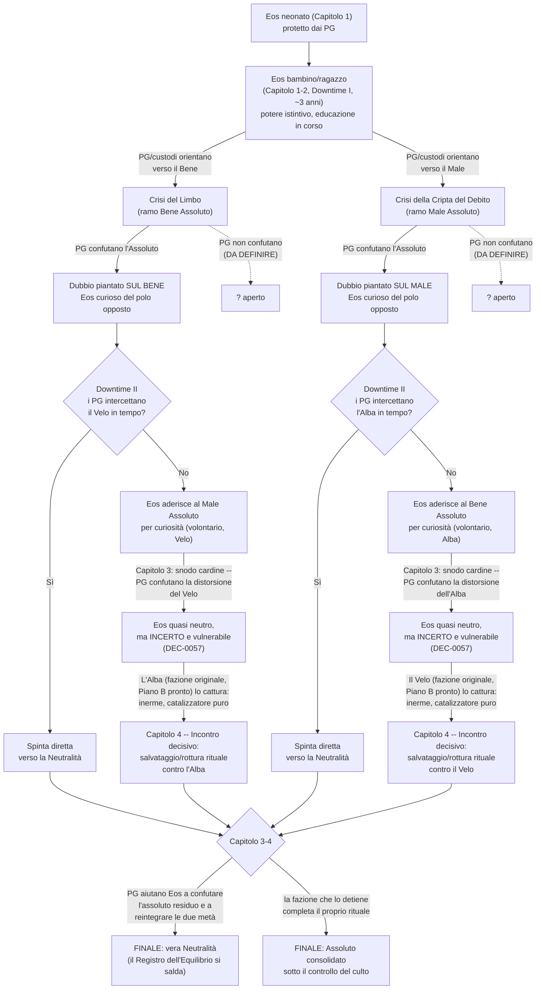

# Child of Balance — Campaign Bible

Versione 0.2 · Canone narrativo recuperato · 9 ottobre 2026

Fonte primaria per questa revisione: ricostruzione narrativa della conversazione "Canto profetico" fornita dall'autore in chat il 9 ottobre 2026.

Responsabilità editoriale: l'autore/GM decide il canone; l'assistente propone, verifica la coerenza, conserva e aggiorna i documenti.

## 0. Regole di lettura e stati

- **CONFERMATO** = decisione esplicita dell'autore riportata nella ricostruzione oppure confermata direttamente.
- **IPOTESI** = proposta valida ma non approvata.
- **SCARTATO** = proposta respinta o superata.
- **DA DEFINIRE** = informazione mancante che richiede una nuova scelta.

Non promuovere automaticamente a canone una proposta dell'assistente. Le descrizioni di Forgotten Realms modificate per la campagna costituiscono homebrew narrativo e non lore ufficiale.

## 1. Identità e premessa

- CONFERMATO — Titolo: Child of Balance.
- CONFERMATO — Genere: fantasy epico e mitologico; intrigo religioso, conflitti cosmici e dilemmi morali.
- CONFERMATO — Ambientazione: Forgotten Realms. Sistema di gioco: Dungeons & Dragons 5e, regole 2014.
- CONFERMATO — Doppio orizzonte creativo: campagna giocabile e romanzo fantasy che condividono una trama robusta.
- CONFERMATO — Premessa: Eos è un essere impossibile generato dall'unione delle divinità Lathander e Shar e contiene poteri divini normalmente contrapposti. Il suo potere potrebbe alterare rapporti di forza tra divinità, schieramenti e alleati.
- CONFERMATO — La sua esistenza NON è intrinsecamente malvagia e non rappresenta automaticamente un pericolo per la cosmologia. Il pericolo concreto è l'appropriazione e strumentalizzazione del suo potere da parte di assolutisti.
- CONFERMATO — "Equilibrio" non significa neutralità morale, né equivalenza fra bene e male.

## 2. Il mito di origine

- CONFERMATO — Lathander e Shar si riconoscono, pur diversi, nella solitudine e nella fermezza delle proprie convinzioni.
- CONFERMATO — Assumono le sembianze rispettive di un angelo e di un demone; si incontrano in un mondo di grigi dove luce e ombra si completano.
- CONFERMATO — Dalla loro unione nasce il primo Eos.
- CONFERMATO — Potenze celesti e abissali scoprono il nascituro e tentano di rivendicarne il potere; Lathander e Shar lo nascondono nel mondo mortale.

NOTA DI LORE — L'unione romantico-genitoriale tra Lathander e Shar è una scelta originale della campagna, non un evento canonico dei Forgotten Realms. Distinguere le ipotesi di "poteri celesti e abissali" dai due culti che saranno i principali antagonisti in epoca successiva.

## 3. Il primo Eos e la sua discendenza

- CONFERMATO — Il primo Eos vive migliaia di anni in incognito, assumendo l'identità di un druido elfo.
- CONFERMATO — Genera discendenti che ereditano il suo sangue ancestrale senza manifestare gli stessi poteri.
- CONFERMATO — Stanco dell'esistenza millenaria, sceglie volontariamente di morire e accetta il ciclo naturale di vita, morte e rinascita.
- CONFERMATO — Secoli dopo, una profezia annuncia l'arrivo di un nuovo Eos, che sarà un neonato al centro della campagna.
- IPOTESI — Il nuovo Eos potrebbe essere reincarnazione della stessa anima, nuova manifestazione del potere o discendente in cui il potere si risveglia. Nessuna versione è stata scelta.
- DA DEFINIRE — Genitori mortali del nuovo Eos, causa del risveglio e rapporto esatto fra antico e nuovo Eos.

## 4. Natura e limiti del potere

- CONFERMATO — Eos porta il potere di entrambi i genitori; può influenzare domini e forze divine contrapposte ed essere un ago della bilancia fra schieramenti cosmici.
- CONFERMATO — Il suo potere interessa sia entità benevole sia entità malvagie.
- IPOTESI — Amplificare domini divini; fungere da condotto; combinare energie incompatibili; trasferire il potere ad altri.
- DA DEFINIRE — Regole concrete del potere, limiti, costi, conseguenze materiali del suo sfruttamento; natura ontologica: divinità, semidio o categoria nuova.

Principio guida: nessuna forma di potere può rendere Eos un deus ex machina che toglie ai PG la scelta finale.

## 5. Lathander e Shar

- CONFERMATO — Sono genitori protettivi; entrambi desiderano proteggere Eos, mantenerne segreta l'identità e impedirne l'uso da parte di terzi.
- CONFERMATO — NON sono antagonisti, NON intendono servirsi del figlio per prevalere l'uno sull'altra e NON sono i mandanti dei culti clandestini.
- IPOTESI — Protezioni indirette mediante presagi, sogni o occultamento di tracce.
- DA DEFINIRE — Perché non possano o non vogliano intervenire più direttamente; rapporti attuali fra i due; ostacoli concreti e credibili alla loro onniscienza/interferenza.

NOTA DI REGOLE — La revoca automatica dei poteri a chierici o paladini dissidenti non è una regola generale D&D 5e 2014: non usarla come semplice scorciatoia narrativa.

## 6. Due culti antagonisti clandestini

- CONFERMATO — Esistono due organizzazioni segrete, una benevola nelle aspirazioni e una malvagia, entrambe assolutiste.
- CONFERMATO — Hanno legami storici o ideologici con Lathander e Shar, ma NON seguono necessariamente i loro dogmi e NON dipendono dal loro potere.
- CONFERMATO — Possono includere devoti di diverse divinità, temono anche la scoperta da parte dei genitori di Eos, e cercano principalmente il CONTROLLO del suo potere, non necessariamente la sua morte.
- IPOTESI — Nome "Ordine dell'Alba Incorrotta": idealismo della luce e del bene imposto; origini fra ex chierici/studiosi/guerrieri legati a Lathander; magia arcana, reliquie e rituali indipendenti.
- IPOTESI — Nome "Velo dell'Ultima Quiete": idealismo oscuro di una quiete definitiva, anche sopprimendo memoria, speranza e libertà; origini fra ex seguaci di Shar e studiosi dello Shadowfell; rituali oscuri ed entità extraplanari.
- DA DEFINIRE — Nomi, vertici, simboli, patroni alternativi, risorse, reclutamento, infiltrazione, basi, obiettivi intermedi e piani operativi.

CRITICITÀ — La fazione "benevola" non deve ridursi a una caricatura autoritaria: prevedere persone sinceramente altruiste e risultati reali. La fazione oscura deve avere un motivo concreto per utilizzare Eos anziché distruggerlo.

## 7. Il Canto Profetico

- CONFERMATO — Esiste un corpus di testi fondativi: mito originario italiano, traduzione inglese, versioni arcaiche in entrambe le lingue, voice-over italiano/inglese e canto profetico.
- TESTO DI RIFERIMENTO NON DEFINITIVO — "Il Canto del Seme Velato", sottotitolo "Profezia del Figlio del Paradosso"; trascrizione completa in [`the-prophetic-song.md`](./the-prophetic-song.md).

CRITICITÀ — "Alcuni per guidarlo. Altri per spegnerlo." potrebbe suggerire intenti distruttivi, mentre i culti mirano al controllo. Risolvere l'ambiguità senza alterare il testo senza approvazione.

DA DEFINIRE — Autore, custodi, diffusione, rapporto con la nascita e modalità di rivelazione ai PG.

## 8. Incipit confermato

- CONFERMATO — Il primo capitolo apre con i PG presenti alla nascita del nuovo Eos, legati in modo ancora non precisato a un circolo/gruppo druidico che assiste al parto.
- CONFERMATO — La nascita scatena un evento soprannaturale che richiama aggressori interessati al bambino; lo scontro supera le possibilità iniziali dei PG.
- CONFERMATO — Il santuario viene devastato; i druidi aiutano i PG a fuggire affidando loro Eos, e il destino di alcuni presenti rimane incerto.
- CONFERMATO — I PG diventano i principali protettori del neonato; la ricerca di un rifugio e di alleati affidabili dà avvio alla vicenda.
- CONFERMATO — Gli aggressori NON agiscono su mandato di Lathander o Shar e la loro azione deve rimanere clandestina rispetto alle due divinità.
- IPOTESI — Nome "Santuario dei Grigi", ubicazione nell'High Forest, alba immobile, ombre innaturali, unico pianto del bambino.
- IPOTESI — Aggressori come angeli/demoni oppure incursori mascherati/sabotatori. Nessuna tipologia è stata approvata.

## 9. Progressione e downtime

- CONFERMATO — Si vuole una campagna di alto livello con prospettiva 1–20. Livello iniziale confermato a 1 (DEC-0033, 12/10/2026); la fascia finale esatta resta da decidere al Gate E.
- CONFERMATO — Progressione di portata da minacce locali a conflitti cosmici, con downtime sufficienti a giustificare la crescita di Eos e la maturazione dei PG anche nella versione romanzesca.
- IPOTESI — Cinque fasi: nascita/fuga; custodi; contesa; guerra nascosta; destino della bilancia.
- IPOTESI — Salti temporali di 3–5, 5–10, 10–20, fino a 20–50 anni; durate esemplificative, non approvate.

CRITICITÀ — Considerare aspettative di vita diverse dei PG; milestone di livello e downtime non coincidono automaticamente.

## 10. Agency dei giocatori e finale

- CONFERMATO — I PG NON devono assistere passivamente alla scelta autonoma di Eos. Le loro decisioni hanno conseguenze rilevanti, tangibili e possibilmente irreversibili.
- CONFERMATO — I culti devono offrire motivazioni e tentazioni sufficientemente credibili perché la possibilità di affidare loro Eos sia una scelta drammatica reale.
- IPOTESI — Egemonia benevola ma coercitiva; distribuzione del potere; utilizzo singolo con sacrificio; preservazione del potere fuori dalle mani dei culti.
- DA DEFINIRE — Come rispettare contemporaneamente l'autonomia di Eos adulto e la centralità dei PG; quale minaccia concreta imponga la decisione finale.

## 11. Idee esplicitamente scartate

- SCARTATO — Lathander e Shar come antagonisti diretti.
- SCARTATO — Culti ufficiali dei genitori come antagonisti principali che agiscono in loro nome.
- SCARTATO — Eos come minaccia automatica per il semplice fatto di incarnare un paradosso o essere neutrale.
- SCARTATO — Terza fazione motivata solo dal "correggere il paradosso".
- SCARTATO — Morte di Eos come obiettivo inevitabile degli antagonisti.
- SCARTATO — Campagna lunga fondata solo su cancellazione di tracce e anomalie astratte.
- SCARTATO — Finale in cui Eos decide tutto mentre i PG osservano.
- SCARTATO — Rinuncia/annullamento obbligatorio del potere come unico finale.

PRECISAZIONE — Non è stata scartata la battaglia iniziale spettacolare; rimangono da definire le identità e motivazioni degli assalitori.

## 12. Registro delle decisioni

| ID | Stato | Decisione |
|---|---|---|
| DEC-0001 | CONFERMATO | Sistema D&D 5e 2014; lore Forgotten Realms. |
| DEC-0002 | CONFERMATO (editoriale) | ChatGPT come sede del lavoro creativo; Google Drive come memoria documentale; GitHub come sede dei sorgenti di pubblicazione. |
| DEC-0003 | CONFERMATO (tecnico) | Target The Forge / Foundry V14 build 365 / dnd5e 5.3.3 / Plutonium 2.18.1-v14. |
| DEC-0004 | CONFERMATO (editoriale) | Repository di progetto autonomo; intenzione di renderlo pubblico ove possibile. |
| DEC-0005 | CONFERMATO (tecnico) | Mostri standard tramite Plutonium nel mondo del GM; contenuti originali distribuiti e mapping per UUID. |
| DEC-0006 | 2026-10-09 CONFERMATO (narrativo) | Eos, figlio di Lathander e Shar; i genitori lo proteggono; conflitto dovuto a usurpazione del potere. |
| DEC-0007 | 2026-10-09 CONFERMATO (narrativo) | Primo Eos druido elfo, discendenza mortale, scelta di morire, futuro nuovo Eos. |
| DEC-0008 | 2026-10-09 CONFERMATO (narrativo) | Due culti clandestini e assolutisti indipendenti dal potere dei genitori. |
| DEC-0009 | 2026-10-09 CONFERMATO (narrativo) | Nascita al santuario druidico, attacco, fuga dei PG con il neonato. |
| DEC-0010 | 2026-10-09 CONFERMATO (narrativo) | Protagonismo dei PG nel finale; downtime e crescita di Eos. |
| DEC-0011 | 2026-10-09 RIFERIMENTO ATTUALE, NON DEFINITIVO | Canto del Seme Velato. |
| DEC-0012 | CONFERMATO PER L'ARCO, POSIZIONE GLOBALE APERTA | Eos Bene Assoluto, Limbo di detenzione preventiva, parte oscura come chiave. |
| DEC-0013 | ESITO AUTORIALE PREVISTO PER L'ARCO, MECCANICA NON DEFINITA | Il dubbio deve consentire alla parte oscura di volgere Eos al Male. |
| DEC-0014 | CONFERMATO | I PG possono guidare Eos verso Bene Assoluto oppure Male Assoluto; la loro forma definitiva come rami non è fissata. |
| DEC-0015 | CONFERMATO | Il Bene Assoluto non si identifica automaticamente con eliminazione di dolore e sofferenza; usare Ilmater come controesempio morale. |
| DEC-0016 | CONFERMATO COME REQUISITO DI DESIGN | Dilemmi di male minore credibili con conseguenze concrete, senza alternative rese artificialmente impossibili. |
| DEC-0017 | APPROVATO LIMITATAMENTE | Le Impronte nascono soltanto da manifestazioni eccezionali di Eos; non sono ricavabili da sangue, capelli o parti del corpo prelevate normalmente. |
| DEC-0018 | CONFERMATO | Struttura desiderata di almeno quattro capitoli e tre downtime con effetti narrativi rilevanti. |
| DEC-0019 | CONFERMATO COME DIREZIONE DI PROGETTO | Il primo downtime conduce alla crisi del Limbo (o controparte malvagia); Eos si allontana per comprendere la propria natura. Il secondo downtime valorizza reliquie e manifestazioni di Eos. |
| DEC-0020 | CONFERMATO COME REQUISITO STILISTICO | Pochi combattimenti, molte decisioni e intrighi; uso prevalente di abilità, capacità di classe, magia creativa e pianificazione. Dungeon crawling non prioritario. |
| DEC-0021 | 2026-10-12 CONFERMATO (narrativo/filosofico) | Il Bene Assoluto non è verità cosmica oggettiva né mandato di Lathander/Shar: è, come la Legge del Prezzo del Male Assoluto, una dottrina elaborata e imposta autonomamente da Eos attraverso un proprio ragionamento. Il giudizio preventivo e la segregazione nel Limbo sono applicazioni di questa dottrina tramite il potere di Eos, non proprietà intrinseche del potere in sé. La dottrina resta filosoficamente contestabile (Ilmater come controesempio) esattamente come la Legge del Prezzo. Risolve la TENSIONE MORALE in [Gli Assoluti e il Male Necessario §12](./gli-assoluti-e-il-male-necessario.md) e la TENSIONE D in [Il Limbo di Eos §10](./il-limbo-di-eos.md). |
| DEC-0022 | 2026-10-12 CONFERMATO (editoriale) | Claude Code (questa sessione e le successive in questo repository) sostituisce ChatGPT come interfaccia primaria per decisioni creative e tecniche. ChatGPT non è più utilizzato per questo progetto. Google Drive resta solo come archivio storico delle ricostruzioni e deposito di asset grezzi pre-ottimizzazione, non più luogo di editing del testo narrativo canonico (supersede parzialmente DEC-0002). |
| DEC-0023 | 2026-10-12 CONFERMATO (editoriale) | Il doppio binario "romanzo fantasy" (§1) è rimandato: nessun lavoro sul romanzo prima che la campagna raggiunga un vertical slice giocabile (Gate F della Narrative Roadmap). |
| DEC-0024 | 2026-10-12 CONFERMATO (stile/design) | Taglio dell'avventura morale e investigativo, non puramente epico-militare: ampio spazio al gioco fuori dal combattimento. Le varianti creative per evitare/semplificare uno scontro richiedono comunque costo/rischio/abilità reali — "semplificare" non equivale a "risolvere facilmente". Dettagli in [Principi di Design §0 e §1](./principi-di-design.md). |
| DEC-0025 | 2026-10-12 CONFERMATO (stile/design) | L'avventura deve ancorarsi quanto più possibile alla Forgotten Realms reale (luoghi, fazioni, eventuali PNG storici), oltre al mito homebrew di Eos. Dettagli in [Principi di Design §6](./principi-di-design.md). |
| DEC-0026 | 2026-10-12 CONFERMATO (Gate A) | Il potere di Eos unisce TUTTE le antitesi (non solo luce/ombra): influenza potenziale su ogni dominio divino e scuola di magia, sblocco progressivo con l'età (neonato=nulla, ragazzo=episodi istintivi/Impronte, adulto=piena Manifestazione Volontaria). Dettagli in [Potere di Eos §16.1](./potere-di-eos-workshop.md). |
| DEC-0027 | 2026-10-12 CONFERMATO (Gate A) | Il vero destino di Eos è la Neutralità druidica (True Neutral): non interviene per bene o male ma secondo l'ordine naturale; non prevarica vita/morte; non decide per altri cosa sia giusto/sbagliato; lascia ai mortali la scelta del proprio destino; nessun assoluto soddisfa tutto; non c'è Luce senza Ombra. Spiega perché il primo Eos era druido (DEC-0007) e la profezia affidata ai druidi. Dettagli in [Potere di Eos §16.2](./potere-di-eos-workshop.md). |
| DEC-0028 | 2026-10-12 CONFERMATO (Gate A) | "Equilibrio non significa neutralità morale" (§1) riguarda il messaggio generale del mondo (bene/male restano distinti); il destino di Eos verso la Neutralità druidica riguarda solo il SUO ruolo cosmico — affermazioni diverse e compatibili. Identifica l'errore filosofico comune a Bene Assoluto e Male Assoluto (apertura di DEC-0021): entrambi violano gli stessi due precetti neutrali (decidere per altri, prevaricare vita/morte). Dettagli in [Potere di Eos §16.3](./potere-di-eos-workshop.md). |
| DEC-0029 | 2026-10-12 CONFERMATO (Gate A) | Censimento di 6 Impronte-reliquie, una per ciascuna coppia di domini da Chierico canonici (Vita/Morte, Luce/Ombra, Conoscenza/Inganno, Creazione/Distruzione, Guerra/Pace, Natura/Arcano): Cuore Bicolore, Velo Strappato, Specchio Incrinato, Seme di Tempesta, Tamburo Silenzioso, Radice Incantata. Ciascuna ha due poteri ASSOLUTI (totali, incondizionati) legati al proprio dominio, non un effetto fisso con costo automatico. Nate dal surge di potere alla nascita di Eos, coerenti con DEC-0017. Dettagli in [Potere di Eos §16.4](./potere-di-eos-workshop.md). |
| DEC-0030 | 2026-10-12 CONFERMATO (Gate A) | Ogni potere di ogni reliquia ha un trigger semplice e diretto (nessuna messa in scena elaborata), vantaggioso per entrambi i culti con scopi opposti e occasionalmente tentante per i PG; la frequenza resta limitata dall'economia delle cariche già proposta nel workshop. Il recupero di ciascuna reliquia è pensato per generare una propria avventura/arco. Dettagli in [Potere di Eos §16.4](./potere-di-eos-workshop.md). |
| DEC-0031 | 2026-10-12 CONFERMATO (Gate A) | Registro dell'Equilibrio: ogni uso significativo di una reliquia che squilibra qualcosa viene annotato; quando Eos raggiunge la Neutralità, ogni voce si salda contemporaneamente (inversione). Si applica uniformemente a tutte e 5 le reliquie. Meccanismo di costo primario del potere di Eos. Dettagli in [Potere di Eos §16.5](./potere-di-eos-workshop.md). |
| DEC-0032 | 2026-10-12 CONFERMATO (tema) | La campagna insegna ai PG ad accettare conseguenze/equilibrio e la mortalità come capacità, non solo limite. I PG devono essere tentati all'uso smodato delle reliquie e pagarne le conseguenze. Dettagli in [Potere di Eos §16.6](./potere-di-eos-workshop.md) e [Principi di Design §7](./principi-di-design.md). |
| DEC-0033 | 2026-10-12 CONFERMATO (Gate E, nota) | Il livello iniziale della campagna è 1 (chiude parzialmente Q-007). La fascia finale resta da decidere formalmente al Gate E; nota di lavoro: si propende per un range ampio (vicino a 1–20) per dare spazio alle 6 avventure di recupero delle reliquie senza affollare i 4 capitoli principali. Dettagli in [Potere di Eos §16.7](./potere-di-eos-workshop.md). |
| DEC-0034 | 2026-10-12 CONFERMATO (Gate B) | Lathander e Shar non intervengono/comunicano direttamente con Eos per tre ragioni: (1) cosmologica — il Patto degli Avatar di Ao rischia di attirare l'attenzione del Supremo su un intervento prolungato; (2) scelta consapevole — guidarlo direttamente significherebbe decidere per lui, contro la sua vera natura (DEC-0027); (3) tattica — un canale diretto lascerebbe una traccia rilevabile dai culti. Restano solo segnali indiretti (sogni, presagi). |
| DEC-0035 | 2026-10-12 CONFERMATO (Gate B) | I veri patroni dei due culti, nessuno dei quali agisce per conto di Lathander/Shar: l'Ordine dell'Alba Incorrotta è sostenuto da elementi rinnegati dei Sunmaster (clero di Amaunator, storicamente rivale di Lathander); il Velo dell'Ultima Quiete da cellule rinnegate degli Shadovar di Thultanthar (fedeli di Shar per cultura/stato, ma mossi da ambizione imperiale netherese, non dalla volontà di Shar). |
| DEC-0036 | 2026-10-12 CONFERMATO (Gate B) | Scappatoie: i culti sanno che i genitori non intervengono apertamente (rinforza la plausibilità dell'assalto al santuario); un uso eccessivo/troppo visibile del potere di Eos rischia di attirare Ao, minaccia per tutti — deterrente aggiuntivo oltre al Registro dell'Equilibrio; il Canto Profetico circola proprio perché resta sotto la soglia d'attenzione di Ao; i PG possono ottenere un canale d'aiuto discreto se chiedono ai genitori senza invocazioni plateali. |
| DEC-0037 | 2026-10-12 CONFERMATO (Gate C, preliminare) | Le 6 Impronte nascono in UN'UNICA ondata, dal surge alla nascita di Eos (nessuna seconda ondata dalla crisi del Limbo). "Diventano centrali nel Downtime II" (`architettura-campagna.md`) si legge come spostamento del fuoco narrativo, non come un secondo evento di creazione. Prima del surge erano doni cerimoniali già presenti per la nascita (parallelo con oro/incenso/mirra: albero sacro, sorgente, circolo druidico e oggetti legati) — il surge le trasforma in Impronte vere, non le crea dal nulla. Dettagli in [Potere di Eos §17.1](./potere-di-eos-workshop.md). |
| DEC-0038 | 2026-10-12 CONFERMATO (Gate C, preliminare) | Distribuzione delle 6 reliquie durante l'assalto al santuario, con un meccanismo narrativo specifico per ciascuna (non il caso): Cuore Bicolore a un infiltrato dell'Alba già presente; Velo Strappato spogliato da un caduto nel caos dal Velo; Specchio Incrinato affidato deliberatamente ai PG dai druidi superstiti insieme al neonato; Seme di Tempesta perduto nel sottobosco; Tamburo Silenzioso disperso con un druido fuggito in direzione opposta (sorte incerta); Radice Incantata divisa preventivamente in due talee da un druido anziano. Risultato: 1 reliquia a testa per fazione, 1 ai PG, 3 perdute/disperse — nessun culto vince materialmente l'assalto. Dettagli in [Potere di Eos §17.2](./potere-di-eos-workshop.md). |
| DEC-0039 | 2026-10-12 CONFERMATO (Gate C, preliminare) | La Benedizione di Eos: esclusiva dei PG, funziona come scudo di gruppo (non immunità generica) — un benedetto può usare una reliquia su un altro benedetto (vulnerabilità reciproca intatta, dilemmi morali fra compagni preservati), ma le reliquie impugnate da un non benedetto non hanno effetto su un bersaglio benedetto. Nessun rito/incontro/scambio da gestire: è condizione strutturale del legame dei PG con Eos fin dall'inizio, non una scelta attiva di Eos (resta coerente con DEC-0027). Dettagli in [Potere di Eos §17.3](./potere-di-eos-workshop.md). |
| DEC-0040 | 2026-10-12 CONFERMATO (Gate C, preliminare) | Contromisure dei leader dei culti, separate da Eos (nessun leader nemico lo ha mai incontrato, coerente con DEC-0035): l'Alba Incorrotta ha un antico rito solare dei Sunmaster di Amaunator; il Velo dell'Ultima Quiete un'antica protezione ombra netherese degli Shadovar di Thultanthar. Entrambe proteggono da QUALSIASI reliquia (non solo quella della propria fazione), sono costose/lente da ottenere (anni, non un rituale rapido) e riservate ai vertici più fidati. Dettagli in [Potere di Eos §17.4](./potere-di-eos-workshop.md). |
| DEC-0041 | 2026-10-12 CONFERMATO (Gate C) | Risultato finale dei due culti in due fasi, speculari: finché Eos è bambino/ragazzo, rubano frammenti di potere dalle reliquie già in loro possesso e cercano di influenzarne l'educazione verso il proprio assoluto (DEC-0019); quando è adulto, chi ha avuto più successo nell'educarlo (o lo cattura) dirige quel potere su scala civile — l'Alba Incorrotta impone un'unica fede solare rigida sulla regione; il Velo dell'Ultima Quiete ricostruisce il dominio imperiale di Netheril, sopprimendo libero arbitrio/memoria/speranza. Dettagli in [Characters & Factions §4-5](./characters-and-factions.md). |
| DEC-0042 | 2026-10-12 CONFERMATO (Gate C) | Piano operativo completo dell'Ordine dell'Alba Incorrotta: 3 obiettivi intermedi (infiltrare la custodia di Eos, costruire legittimità pubblica con resurrezioni in scena, infiltrare il clero/le istituzioni civiche per preparare l'accettazione pubblica di Eos adulto); mezzi (rete di Sunmaster rinnegati, Cuore Bicolore, legittimità religiosa di Amaunator); costi/limiti (Registro dell'Equilibrio, economia delle cariche, Presa riservata a eliminazioni clandestine); indizi per i PG; punti deboli (dipendenza dalla vicinanza a Eos, fragilità della facciata, zelo sincero vulnerabile a crisi di fede); aspetti seducenti (miracoli veri, ordine regionale, bersagli autenticamente corrotti); Piano B (cattura diretta se l'infiltrazione fallisce). Dettagli in [Characters & Factions §4](./characters-and-factions.md). |
| DEC-0043 | 2026-10-12 CONFERMATO (Gate C) | Piano operativo completo del Velo dell'Ultima Quiete: 3 obiettivi intermedi (infiltrare la custodia di Eos con metodi da ombra, usare il Velo Strappato per ricatti/sparizioni clandestine invece di legittimità pubblica, riattivare leve imperiali netheresi dormienti); mezzi (agenti Shadovar di Thultanthar, Velo Strappato, conoscenza netherese, rete di ricatti); costi/limiti (Registro dell'Equilibrio, rischio che Eos ritorca la Legge del Prezzo contro i maestri); indizi per i PG (sparizioni di informazioni, "incidenti" a prezzo equivalente, consiglieri non identificati); punti deboli (dipendenza da cariche/vicinanza, l'occultamento stesso come indizio, ranghi inferiori sinceramente convinti che si alienerebbero se il vero fine fosse esposto); aspetti seducenti (onestà brutale della Legge del Prezzo, pace nichilista); Piano B (occultare ogni traccia dell'importanza di Eos piuttosto che perderlo a un rivale). Dettagli in [Characters & Factions §5](./characters-and-factions.md). **Obiettivo 1 rivisto da DEC-0044.** |
| DEC-0044 | 2026-10-12 CONFERMATO (Gate C, revisione) | L'Obiettivo 1 di entrambi i piani (DEC-0042, DEC-0043) rivisto: i culti NON hanno contatto diretto con Eos finché è protetto dai PG (Capitoli 1-2/Downtime I) — agiscono solo nelle retrovie (localizzazione a distanza, senza successo). La prima vera finestra di contatto si apre dopo la crisi del Limbo, quando Eos si allontana volontariamente dal gruppo (Downtime II): è lì che un mentore/agente di ciascun culto lo intercetta e tenta di orientarlo verso il proprio assoluto, offrendogli la certezza morale (Alba) o la "verità liberatoria" (Velo) che sta cercando in un momento di dubbio. Osservazione dell'autore: un'infiltrazione nella cerchia di fiducia dei PG mentre Eos è con loro non è credibile, dato quanto lo proteggono. Dettagli in [Characters & Factions §4-5](./characters-and-factions.md). |
| DEC-0045 | 2026-10-12 CONFERMATO (Gate C) | Matrice completa Obiettivi→Operazioni→Indizi→Reazioni dei PG→Conseguenze per entrambi i piani operativi, incorporando la revisione DEC-0044. Ogni riga offre più reazioni praticabili senza binari forzati. Dettagli in [Characters & Factions §10](./characters-and-factions.md). |
| DEC-0046 | 2026-10-13 CONFERMATO (Gate D) | Eos è intrinsecamente duale: due entità/metà immature, riflesso diretto dell'opposizione dei suoi genitori (domini di Lathander e Shar), entrambe mosse da autoconservazione. Se Eos diventa un Assoluto, una delle due metà non può più sopravvivere. La "parte oscura" imprigionata nel Limbo cerca di far vacillare Eos non per malizia, ma perché la coesistenza non è un'opzione finché lui resta un Assoluto — spera in uno spiraglio di sopravvivenza, non garantisce una presa di potere. Le prove del Limbo richiedono ai PG di confutare l'Assoluto del Bene portando Eos ad accettare che male e sofferenza hanno un ruolo nell'ordine naturale (applicazione concreta di DEC-0027) — non di commettere o indurre atti malvagi. Dettagli in [Il Limbo di Eos §14](./il-limbo-di-eos.md). |
| DEC-0047 | 2026-10-13 CONFERMATO (Gate D) | Per simmetria con DEC-0046: nel ramo Male Assoluto (Legge del Prezzo) è la metà BUONA di Eos a non poter sopravvivere, imprigionata non per giudizio preventivo ma in una prigione di contabilità infinita — ogni gesto di bontà spontanea convertito in debito, perché la Legge del Prezzo non tollera eccezioni gratuite. Le prove dei PG in questo ramo (eventuale) dovrebbero confutare la premessa opposta: la grazia immeritata ha anch'essa un ruolo necessario nell'ordine naturale, la metà mancante di "non c'è Luce senza Ombra". Dettagli in [Gli Assoluti e il Male Necessario §22](./gli-assoluti-e-il-male-necessario.md). |
| DEC-0048 | 2026-10-13 CONFERMATO (Gate D) | La via degli Assoluti è una ramificazione (Capitoli 1-2: l'influenza dei PG/custodi determina verso quale assoluto Eos scivola) che diventa una fase transitoria (Downtime II/Capitoli 3-4: l'Assoluto è il problema centrale, i culti competono per dirigerlo/consolidarlo, i PG possono aiutare Eos a confutarlo e trovare la Neutralità) — e diventa un finale possibile SOLO se i PG non riescono in tempo o un culto vince (Gate C): un epilogo cupo, non l'unico né scontato. Lega esplicitamente Gate C e Gate D: vittoria di un culto e finale da Assoluto bloccato sono la stessa cosa da due angolazioni. Dettagli in [Gli Assoluti e il Male Necessario D-A03](./gli-assoluti-e-il-male-necessario.md) e [Il Limbo di Eos Q-L08](./il-limbo-di-eos.md). |
| DEC-0049 | 2026-10-13 CONFERMATO (Gate E) | Correzione fondamentale: i downtime NON sono sessioni giocate — sono periodi dove l'avventura si sviluppa fuori dal controllo dei PG, che scelgono solo attività passive (ricerche, allenamento, progetti) risolte narrativamente, senza scene d'avventura. Servono a consegnare informazioni chiave che aprono il capitolo successivo (es. dopo il Limbo: notizie di resurrezioni e sparizioni, prime tracce dei due culti). Nessun PNG rintracciabile conosce la vera natura di Eos (la sua precedente incarnazione è troppo lontana nel tempo, restano solo indizi frammentari) — la conoscenza va centellinata per evitare che i PG arrivino alla verità troppo in fretta. I PG non sanno inizialmente nemmeno di avere la Benedizione di Eos: agiscono solo perché la profezia dice di salvarlo e accudirlo. Supersede le descrizioni di downtime attivo in `architettura-campagna.md` §2-3 (9 ottobre 2026, corrette in loco). |
| DEC-0050 | 2026-10-13 CONFERMATO (Gate E) | Struttura del recupero delle 6 reliquie, tutte come contenuto giocato nei capitoli (mai nei downtime, DEC-0049): il Cuore Bicolore e il Velo Strappato si riconquistano a uno snodo cardine di confronto col culto che le detiene (Alba e Velo rispettivamente) — non quest separate, conseguenza diretta della trama principale; il Seme di Tempesta, il Tamburo Silenzioso e la Radice Incantata richiedono avventure di recupero dedicate, innescate da indizi ottenuti in downtime, eventualmente contese con i culti o finite nelle mani di terzi. Vincolo esplicito dell'autore: le tre avventure dedicate devono restare nel contesto dell'avventura principale — indizi di lore e PNG sempre connessi a Eos, nessuna avventura a sé stante/disconnessa. |
| DEC-0051 | 2026-10-13 CONFERMATO (Gate E) | Fascia di livelli confermata, range completo 1-20, distribuita sui 4 capitoli: Capitolo 1 (nascita/fuga/custodia) livelli 1-3; Capitolo 2 (crisi dell'Assoluto) livelli 4-7; Capitolo 3 ("La Guerra Invisibile" — le tre avventure dedicate di recupero reliquie più uno dei due scontri cardine coi culti, macro-arco lungo) livelli 7-15; Capitolo 4 (climax, scontro cardine rimanente, liberazione/confronto con Eos) livelli 15-20. I tre downtime non occupano livelli propri (non sono sessioni, DEC-0049). Nota di contingenza dell'autore: se le tre avventure dedicate di recupero non risulteranno coese con la trama principale una volta scritte, si potrà suddividere ulteriormente il Capitolo 3 con "mini-downtime" intermedi — decisione rimandata alla stesura effettiva, non presa ora. |
| DEC-0052 | 2026-10-13 CONFERMATO (Gate E) | Origine del nuovo Eos: reincarnazione per discendenza diretta — dopo diverse generazioni nella stirpe lasciata dal primo Eos (DEC-0007), nasce di nuovo da due genitori mortali ordinari, discendenti di quella stirpe. Nessuna concezione immacolata o genitore unico (scartato esplicitamente: complicazione non necessaria). Il parto è normale; sono i segnali che lo accompagnano (presagi, coincidenze) a renderlo riconoscibile al circolo druidico come l'evento profetizzato. Entrambi i genitori muoiono nell'assalto al santuario come vittime dell'attacco (non per ragioni mistiche legate al parto) — rende i PG gli unici custodi fin da subito, coerente con DEC-0049. Spunto non sviluppato: indagare la genealogia dei genitori può diventare un indizio frammentario/avventura. Dettagli in [Characters & Factions §1](./characters-and-factions.md). |
| DEC-0053 | 2026-10-13 CONFERMATO (Gate E) | Diffusione del Canto del Seme Velato: composto/ricevuto dal primo Eos prima di scegliere la morte, affidato al proprio circolo druidico come mandato sacro. I culti non hanno il testo originale — ciascuno ha costruito una propria lettura parziale e distorta da tradizioni indipendenti che nei secoli hanno registrato frammenti della stessa verità (presagi astronomici di Amaunator per l'Alba Incorrotta, lore ombra netherese per il Velo), spiegando perché le loro interpretazioni divergano pur rispondendo allo stesso evento. I PG ricevono dai druidi solo l'estratto rilevante al proprio mandato, non il testo integrale. Presentazione in sessione: recitata incompleta da un druido in fuga/morente durante la fuga del Capitolo 1; il testo integrale resta una scoperta successiva eventuale. Dettagli in [The Prophetic Song](./the-prophetic-song.md). |
| DEC-0054 | 2026-10-13 CONFERMATO (Gate E) | Geografia canonica verificata via web: il santuario della nascita è nella High Forest (foresta antica reale, confina con Anauroch). Correzione di lore: Thultanthar NON è più esiliata nel Piano d'Ombra — è tornata sul Piano Materiale nel 1372 DR come "Città delle Ombre" sopra il deserto di Anauroch, confine orientale della stessa High Forest; le cellule rinnegate del Velo operano lì, contro la politica ufficiale della propria città, non nascoste in un altro piano (supersede la dicitura precedente in DEC-0035 e nel manuale). Precisazione sull'Alba Incorrotta: i Sunmaster sono ora un ramo ufficialmente riconciliato della chiesa di Lathander stessa ("Brotherhood of the Glorious Sun") — l'Alba è uno scisma dall'interno di quella chiesa, non da estranei; Elversult (Dragon Coast) come possibile terreno ideologico/di reclutamento. Dettagli in [Characters & Factions §3-5](./characters-and-factions.md). |
| DEC-0055 | 2026-10-13 CONFERMATO (Gate E) | Cronologia canonica, verificata via web: il presente della campagna è il 1492 DR (standard 5e, dopo il Secondo Rimescolamento). Il primo Eos muore nel -339 DR (Anno delle Ragnatele Spezzate, caduta di Netheril/Follia di Karsus) — oltre 1800 anni prima, abbastanza antico da rendere la sua conoscenza quasi del tutto perduta, ma nello stesso istante storico in cui: il culto di Amaunator (ancora dominante, non rimpiazzato da Lathander) lo conosceva direttamente, dando all'Alba Incorrotta un know-how ancestrale genuino; gli Shadovar si ritirarono nel Piano d'Ombra portando con sé la stessa conoscenza, preservata nell'isolamento fino al ritorno del 1372 DR (DEC-0054), dando al Velo dell'Ultima Quiete il proprio know-how ancestrale. Il nuovo Eos cresce molto più in fretta di un umano: da neonato ad adolescente in non più di 3 anni — un segnale fisico vistoso della sua natura non del tutto umana, visibile ai PG ben prima di qualsiasi manifestazione magica. Comprime il Downtime I a circa 3 anni di tempo reale. Dettagli in [Characters & Factions §1](./characters-and-factions.md). |
| DEC-0056 | 2026-10-13 CONFERMATO (Gate E) | Risolve la domanda aperta dal 9 ottobre in `architettura-campagna.md` §8 (che tipo di controllo ha il culto vincente su Eos al Capitolo IV): meccanismo asimmetrico legato al ramo preso ai Capitoli 1-2. La crisi del Limbo/Cripta del Debito pianta dubbio specificamente sull'Assoluto ORIGINALE di Eos (quello verso cui i PG/custodi lo hanno orientato) — uscendone, Eos è curioso del polo OPPOSTO, non ancora provato. In Downtime II, la fazione opposta al ramo originale ottiene quindi la prima occasione di aderenza VOLONTARIA per curiosità (modello C di §8); la fazione originale, avendo perso la presa ideologica, deve invece SOTTOMETTERLO con la forza, usando il proprio know-how ancestrale (DEC-0055) ed eventualmente le reliquie (modello A/B di §8). Se ramo Bene (Limbo): il Velo ha la prima occasione di curiosità, l'Alba deve sottomettere. Se ramo Male (Cripta del Debito): l'Alba ha la prima occasione di curiosità, il Velo deve sottomettere. Il modello di controllo finale (§8) è quindi un ibrido dipendente dal ramo, non fisso. Dettagli in [Campaign Bible §39](#39-gate-d--diagramma-degli-stati-di-eos-scelte-dei-pg-conseguenze-13-ottobre-2026) (diagramma aggiornato) e [Characters & Factions §4-5](./characters-and-factions.md) (Piani B precisati). |
| DEC-0057 | 2026-10-13 CONFERMATO (Gate E) | Precisa la sequenza di DEC-0056 nel tempo, risolvendo l'incontro decisivo del Gate E: non due forme parallele, ma una sequenza. (1) Dopo il Limbo/Cripta, Eos aderisce volontariamente alla fazione opposta. (2) I PG affrontano quella fazione (snodo cardine del Capitolo 3), confutando la sua distorsione — vincendo, Eos non diventa stabile, ma entra in un periodo di INCERTEZZA che lo rende vulnerabile (ha appena perso un secondo sistema di credenze, senza ancora un ancoraggio proprio). (3) È proprio in quella finestra di vulnerabilità che la fazione ORIGINALE (quella respinta dopo il Limbo, che nel frattempo ha preparato la propria sottomissione forzata, Piano B) lo cattura con la forza, lo rende inerme e lo sfrutta come puro catalizzatore per i propri poteri — non le serve la sua volontà, solo il suo potere. (4) L'incontro decisivo del Capitolo IV è quindi sempre un'operazione di salvataggio/rottura rituale contro la fazione ORIGINALE, non un dialogo con Eos (è inerme, non partecipa attivamente). Una volta liberato, la sua stabilità morale resta intatta — non è stato convertito, solo prosciugato — coerente con "il culto ha ottenuto il potere senza aver vinto la sua volontà" (`architettura-campagna.md` §7-D). Diagramma del Gate D aggiornato per riflettere la sequenza. Dettagli in [Campaign Bible §39, §48](./campaign-bible.md). |
| DEC-0058 | 2026-10-13 CONFERMATO (Gate F) | Formato di gioco delle 6 Impronte di Eos in Appendice B, modellato sulle convenzioni reali degli artefatti DMG (`\DndItemHeader`, "Oggetto meraviglioso, artefatto"): (1) richiedono TUTTE sintonia — rinforza il tema del legame/tentazione personale con l'uso delle reliquie (DEC-0030) e impedisce l'uso casuale da parte di chi ne ruba una senza essersi mai sintonizzato; (2) nessun tiro salvezza su Dono o Presa, coerente con DEC-0039 (sono armi assolute, l'unica difesa è la Benedizione di Eos o le contromisure rituali dei culti, DEC-0040) — non vengono quindi introdotte CD; (3) indistruttibili per ora: nessuna sezione "Distruzione" nei blocchi oggetto, coerente con la loro natura assoluta — resta un gancio narrativo aperto, non deciso, riconsiderabile se la trama ne avrà bisogno più avanti. L'economia delle cariche resta quella già fissata da DEC-0031/§16.5 (2 cariche massimo per reliquia, ricarica di 1 carica ogni 7 giorni condivisa fra tutte e sei, rito di un'ora entro 9 m da Eos). Dettagli in [Potere di Eos §16.5, §17](./potere-di-eos-workshop.md) e `latex/manual/AppendiceB.tex`. |
| DEC-0059 | 2026-10-13 CONFERMATO (Gate F) | Il Capitolo 1 è completo dal Prologo fino al checkpoint di Livello 3, promosso per intero in `latex/manual/Capitolo1.tex`. Dopo la fuga dal Santuario, i PG attraversano le rovine di un avamposto minore di Eaerlann (il regno elfico reale che tenne la High Forest orientale per seimila anni, caduto nell'882 DR per l'orda demoniaca di Ascalhorn/Hellgate Keep) — 9 zone su due parti (Parte 1, Zone 1-4, checkpoint Livello 2; Parte 2, Zone 5-9 incluso un mini-dungeon in 4 sottozone, checkpoint Livello 3), con il branco orco di Grulnak (nuovo statblocco, GS 2) e un quasit intrappolato come incontri motivati, non casuali. Lo scontro clou all'uscita (Zona 9) usa Nyx Kelvorn e il Velo dell'Ultima Quiete anziché l'Alba Incorrotta — scelta di design dell'autore: il Velo legge più chiaramente come minaccia oscura agli occhi dei giocatori (per lo più orientati al bene), rinforzando senza forzare nulla meccanicamente l'istinto a respingerlo, utile a favorire il ramo Bene Assoluto del Limbo. Framework di progettazione riutilizzabile per i capitoli futuri formalizzato in `principi-di-design.md` §8 (ritmo sessione/livello, scontri motivati, esplorazione su prove, trattamento PNG/mostri, stile wiki anche per i luoghi interni alle avventure). Dettagli in [`capitolo1-prologo.md`](./capitolo1-prologo.md) e [`capitolo1-rovine-aelothir.md`](./capitolo1-rovine-aelothir.md). Restano DA FARE: mappa del Santuario (rimandata), dettaglio del rifugio del Downtime I. |
| DEC-0060 | 2026-10-13 CONFERMATO | Rivisti i poteri di tre delle sei Impronte di Eos (DEC-0037 e segg.), corretti perché "troppo forti" nel senso sbagliato: bypassavano la struttura investigativa della campagna invece di rappresentare un dilemma morale con un disfacimento drammaticamente pesante quando Eos trova l'Equilibrio. (1) **Specchio Incrinato** (Conoscenza/Inganno): il Dono non è più un oracolo che risponde a qualsiasi domanda sull'universo (avrebbe reso irrilevante ogni mistero della campagna) -- ora costringe una creatura bersaglio a dire soltanto la verità su ciò che le viene chiesto; la Presa resta l'impiantare una menzogna totale e permanente scelta da chi impugna la reliquia, ma specificamente sulla creatura bersaglio. (2) **Velo Strappato** (Luce/Ombra): il Dono non espone più "tutto ciò che si trova" in un'intera area (avrebbe scansionato via ogni segreto di trama con un solo uso) -- ora espone la vera natura/forma/intenzione di UNA creatura bersaglio; la Presa resta l'occultamento totale, ma di una creatura o un oggetto bersaglio, non di un'intera area. (3) **Radice Incantata** (Natura/Arcano): la Presa non dissolve più esplicitamente "protezioni permanenti o divine" (avrebbe potuto disfare a comando la Benedizione di Eos stessa o le contromisure rituali antiche dei due culti) -- resta la dissoluzione totale di qualsiasi incantesimo/effetto magico attivo su un bersaglio o un'area, senza quella clausola. **Cuore Bicolore, Seme di Tempesta e Tamburo Silenzioso confermati invariati** -- reggono già il criterio (potere assoluto ma non epistemico/scavalcante, disfacimento con peso drammatico reale); per il Tamburo Silenzioso, esplicitato che chi muore come conseguenza diretta del suo uso torna in vita quando Eos trova l'Equilibrio, con lo stesso peso del Cuore Bicolore (stesso dominio vita/morte raggiunto per via indiretta). Dettagli in [Potere di Eos §17.1](./potere-di-eos-workshop.md) e `latex/manual/AppendiceB.tex`. |
| DEC-0061 | 2026-10-13 CONFERMATO | Formalizzato un target quantitativo nel framework di design (`principi-di-design.md` §8.1): **8-15 scene distinte per ogni singolo level-up** (~3-5 a sessione), verificato contro tre moduli ufficiali (Death House ~20-30 stanze/2 livelli, Descent into Avernus Cap.3 ~25 location/3 livelli, Rime of the Frostmaiden 5 di 12 missioni richieste/3 livelli, ciascuna multi-scena) -- tutti convergono sullo stesso intervallo nonostante strutture diverse (corridoio, menu di missioni, point-crawl), confermando che la quantità conta più della struttura organizzativa. La Parte 1 delle rovine di Aelothir (Capitolo 1) aveva solo 4 zone per il checkpoint di Livello 2, sotto il minimo -- espansa a 8 zone aggiungendo Il Crocevia delle Radici (bivio/orientamento), Il Deposito Nascosto (scoperta pratica, provviste del branco di Grulnak), Il Posto di Guardia Abbandonato (indizio su numero/direzione del branco prima dell'incontro), La Cappella Crollata (lore pura su Eaerlann, nessun ostacolo) -- tutte motivate da `principi-di-design.md` §3/§8.8, non riempimento. Rinumerazione a cascata di tutte le zone successive (Parte 1: 1-8). Promosso in `latex/manual/Capitolo1.tex`. Dettagli in [`capitolo1-rovine-aelothir.md`](./capitolo1-rovine-aelothir.md). |
| DEC-0062 | 2026-10-14 CONFERMATO | Applicato lo stesso target 8-15 scene/level-up (DEC-0061) anche alla Parte 2 delle rovine di Aelothir, su richiesta esplicita dell'autore di renderlo una regola sempre valida, non solo per la Parte 1. Parte 2 aveva 8 scene (9a-9d, più 4 zone) per il checkpoint di Livello 3 -- al minimo del range, sotto il target reale per 4 sessioni (12-20). Espansa a 12 scene aggiungendo: L'Avamposto dei Profughi (comunità di non combattenti del branco, indizio indipendente sulla corruzione, utile anche a chi sceglie la via lunga), Il Corridoio dei Segni (lore atmosferica pura, segni di allarme orcheschi crescenti), Il Rifugio di Fortuna (scelta vera fra riposo e sorpresa tattica, nessuna opzione "corretta"), Tracce di un Inseguitore (indizio che si traduce meccanicamente in vantaggio all'iniziativa contro Nyx). Rinumerazione a cascata completa: Parte 2 ora Zone 9-17 (sottozone 9a-9d). Corretta anche la logica del bivio via-diretta/via-lunga nell'introduzione di Parte 2 (entrambe le vie attraversano l'Avamposto e il Capo Orco, divergono solo dopo). Promosso in `latex/manual/Capitolo1.tex` (33→34 pagine). Formalizzata anche la struttura generale del manuale (`principi-di-design.md` §9: apertura con sinossi, apertura di capitolo con livelli/sessioni dichiarati, illustrazioni di capitolo, appendici) -- verificata su Lost Mine of Phandelver e Strixhaven; identificato un gap noto non ancora risolto: la sinossi dell'avventura in `Introduzione.tex` resta un TODO nonostante esista già CONFERMATA in `architettura-campagna.md` §0. Dettagli in [`capitolo1-rovine-aelothir.md`](./capitolo1-rovine-aelothir.md) e [Principi di Design §9](./principi-di-design.md). |
| DEC-0063 | 2026-10-14 CONFERMATO | Risolto il gap identificato in DEC-0062: ``Guida all'Avventura'' / ``Riassunto dell'Avventura'' in `Introduzione.tex` era un TODO letterale nonostante la sinossi esistesse già CONFERMATA in `architettura-campagna.md` §0 (Output del Gate E). Promossa la prosa completa più una `\DndTable` dei quattro capitoli (livelli/scopo/conflitto, incluse le righe di downtime). |
| DEC-0064 | 2026-10-14 CONFERMATO | ``L'assalto'' al Santuario dei Grigi era ancora un elenco astratto di 7 scelte reliquia/PNG senza CD né sequenza di gioco, insieme a ``La Via Sotterranea'' che restava pura narrazione senza una vera scena di passaggio di consegne. Riscritto come sequenza giocabile in 4 fasi: Fase 1 (Il Tradimento dei Mantelli Dorati -- innesco, prova di orientamento CD 10), Fase 2 (Attraverso il Caos -- tabella Zona/conseguenza che mappa ciascuna delle scelte sotto pressione preesistenti sulle 5 zone già stabilite del Santuario, con CD concrete: 16 contrapposta per il Cuore Bicolore, 10 per l'effetto personale di Garrick e Wren, 12 per il Seme di Tempesta, 13 per il Tamburo Silenzioso; ogni deviazione ha un costo esplicito in Fase 3), Fase 3 (La Corsa ai Margini -- 2-3 prove CD 12/14/16 che rendono meccanica, non solo narrata, la nota di bilanciamento "scontro non vincibile di petto"), Fase 4 (La Fuga nel Sottobosco -- nuova PNG minore **Senna Loreleaf**, druida superstite designata da Fendrel come depositaria di riserva del segreto di Aelothir, introdotta per sostituire il generico "un druido superstite" e dare un volto reale al raccordo con la Via Sotterranea e la Zona 1 di Aelothir). Applicato in entrambe le fonti ([`capitolo1-prologo.md`](./capitolo1-prologo.md) §5.6-5.7 e `latex/manual/Capitolo1.tex`), coerente col principio "il fallimento è complicazione, non blocco" (`principi-di-design.md` §8.11) e con gli esiti già fissati (morte di Garrick/Wren DEC-0052, consegna dello Specchio Incrinato a Fendrel). |

Le date DEC-0006 a DEC-0011 indicano la trascrizione della ricostruzione; le decisioni narrative sono antecedenti.

## 13. Questioni critiche da risolvere

- Q-001 — Meccanica concreta del potere di Eos, costo, limiti, vulnerabilità e possibile uso come arma.
- Q-002 — Perché le due divinità non riescano a intervenire direttamente contro i culti pur amando Eos.
- Q-003 — Obiettivi intermedi e piano operativo verificabile dei culti; escalation realistica 1–20/5–20.
- Q-004 — Origine del nuovo Eos, genitori mortali, reincarnazione o risveglio del sangue.
- Q-005 — Provenienza e circolazione della profezia; informazioni note ai culti e ai PG.
- Q-006 — Natura e logistica dell'assalto iniziale, location e druidi sopravvissuti.
- Q-007 — Scelta della progressione dei livelli, età, durata dei downtime e diritti di scelta di Eos adulto.
- Q-008 — Progetto di climax con agenzia dei PG e autonomia morale di Eos.
- Q-009 — Nomi, leader, patrocinatori, simbologie e tattiche delle fazioni.
- Q-010 — Integrazione LaTeX e Foundry, scelta contenuti redistribuibili e test su The Forge.

## 14. Principio operativo

Per i nuovi sviluppi: prima verificare documenti Drive/archivio e registro delle decisioni; etichettare nuove idee e tenerle separate dal canone fino all'approvazione; aggiornare Campaign Bible e documenti secondari dopo le decisioni consolidate.

## 49. Risoluzione del Gate E — output finale (13 ottobre 2026)

Sessione di design diretta con l'autore, dettagli completi in [Architettura della Campagna §0](./architettura-campagna.md#0-output-del-gate-e--sinossi-timeline-tabella-dei-capitoli-13-ottobre-2026). Sintesi:

Compilata la sinossi di una pagina, la timeline con milestone (calendario di Faerûn verificato via web dove applicabile) e la tabella dei capitoli con scopo/conflitto/conseguenze richieste dalla Narrative Roadmap — non nuove decisioni, solo sintesi di tutto quanto confermato oggi e nei gate precedenti (DEC-0037 a DEC-0057). Il Gate E della Narrative Roadmap è RISOLTO: un percorso narrativo principale completo, con ramificazioni gestibili (quale Assoluto, chi intercetta Eos, esito finale), non più una serie di concept slegati.

## 48. Gate E — l'incontro decisivo: la sequenza del Capitolo IV (13 ottobre 2026)

Sessione di design diretta con l'autore, dettagli completi nel diagramma aggiornato in [Campaign Bible §39](#39-gate-d--diagramma-degli-stati-di-eos-scelte-dei-pg-conseguenze-13-ottobre-2026). Sintesi:

Chiude il Gate E precisando nel tempo il meccanismo di DEC-0056: non due forme parallele e indipendenti, ma una vera sequenza drammatica in tre atti. Primo, dopo la crisi del Limbo o della Cripta del Debito, Eos aderisce volontariamente alla fazione opposta al ramo preso, per curiosità. Secondo, i PG affrontano quella fazione a uno snodo cardine del Capitolo 3, confutando la sua distorsione — ma vincere non stabilizza Eos: lo lascia in un periodo di incertezza, senza ancora un ancoraggio morale proprio, genuinamente vulnerabile. Terzo, è proprio in quella finestra che la fazione ORIGINALE — quella respinta dopo il Limbo, che nel frattempo ha preparato la propria sottomissione forzata (Piano B) — lo cattura con la forza, lo rende inerme e lo sfrutta come puro catalizzatore per i propri poteri, senza bisogno della sua volontà.

L'incontro decisivo del Capitolo IV, richiesto dal Gate E, è quindi sempre di questo tipo: un'operazione di salvataggio e rottura rituale contro la fazione originale, non un confronto dialogico con Eos (che resta inerme, non partecipa attivamente alla scena). Una volta liberato, la sua stabilità morale resta intatta — non è stato convertito, solo prosciugato — risolvendo in modo pulito la vecchia tensione di `architettura-campagna.md` §7-D: "ottenuto il potere di Eos" non equivale a "controllo della sua volontà autonoma" (DEC-0057).

## 47. Gate E — chi controlla Eos al Capitolo IV, e come (13 ottobre 2026)

Sessione di design diretta con l'autore, dettagli completi in [Campaign Bible §39](#39-gate-d--diagramma-degli-stati-di-eos-scelte-dei-pg-conseguenze-13-ottobre-2026) (diagramma aggiornato) e [Characters & Factions §4-5](./characters-and-factions.md). Sintesi:

Risolve una domanda rimasta aperta fin dal 9 ottobre in `architettura-campagna.md` §8: quale forma ha il controllo del culto vincente su Eos nel finale — prigionia fisica, rete di risonanza, adesione ideologica genuina, o un modello combinato? La risposta dell'autore è un meccanismo asimmetrico, non una scelta fissa: la crisi del Limbo o della Cripta del Debito pianta dubbio specificamente sull'Assoluto ORIGINALE di Eos (quello verso cui i PG/custodi lo hanno orientato ai Capitoli 1-2) — uscendone, Eos è curioso del polo che non ha ancora provato. È quindi sempre la fazione OPPOSTA al ramo preso a ottenere, in Downtime II, la prima occasione di aderenza VOLONTARIA per curiosità; la fazione originale, avendo perso la propria presa ideologica, deve ricorrere alla sottomissione forzata, usando il know-how ancestrale della propria tradizione (DEC-0055) ed eventualmente le reliquie (DEC-0056).

Questo dà al Capitolo IV una vera posta in gioco duplice: non solo QUALE culto vince, ma COME — un'adesione volontaria di Eos a un Assoluto (dilemma morale: lui stesso ci crede) è un problema diverso da una sottomissione forzata (dilemma tattico: va liberato contro la sua volontà attuale, coerente con l'agency autonoma di Eos adulto, DEC-0010). Entrambe le forme restano fedeli al principio che "il culto ha ottenuto il potere" non equivale automaticamente a "Eos ha perso la libertà morale" (architettura-campagna.md §7-D).

## 46. Gate E — cronologia canonica (13 ottobre 2026)

Sessione di design diretta con l'autore, dettagli completi in [Characters & Factions §1](./characters-and-factions.md). Sintesi:

Il presente della campagna è il 1492 DR, l'anno standard del 5e. La morte del primo Eos è fissata al -339 DR — la caduta di Netheril (Follia di Karsus) — su richiesta esplicita dell'autore di renderla "così in là" da coinvolgere il culto di Amaunator PRIMA che Lathander lo rimpiazzasse, dando un know-how ancestrale genuino anche a quella fazione. La verifica web ha confermato che è esattamente lo stesso momento storico: il culto di Amaunator si spense per abbandono proprio quando Netheril crollò e i suoi superstiti iniziarono a venerare Lathander, e Thultanthar si ritirò nel Piano d'Ombra. Tre fili narrativi — morte del primo Eos, declino di Amaunator, esilio degli Shadovar — convergono sullo stesso istante, dando a entrambi i culti un'origine del proprio know-how ancestrale coerente e verificata, non inventata ad hoc (DEC-0055).

Confermata anche la crescita accelerata del nuovo Eos: da neonato ad adolescente in non più di tre anni, un primo segnale fisico innegabile della sua natura non del tutto umana, visibile ai PG prima di qualsiasi manifestazione di potere deliberata. Questo comprime il Downtime I a circa tre anni di tempo reale.

## 45. Gate E — geografia canonica, con una correzione di lore (13 ottobre 2026)

Sessione di design diretta con l'autore, dettagli completi in [Characters & Factions §3-5](./characters-and-factions.md). Sintesi:

Il santuario della nascita si ancora alla High Forest, reale e verificata via web: foresta antica al confine col deserto di Anauroch, storicamente sede di circoli druidici. Durante la verifica è emersa una correzione di lore importante: Thultanthar non è più esiliata nel Piano d'Ombra come scritto in DEC-0035 — è tornata sul Piano Materiale nel 1372 DR come "Città delle Ombre", e fluttua proprio sopra l'Anauroch, confine orientale della stessa High Forest. Questo non è solo una correzione: è un colpo di fortuna narrativo — significa che le cellule rinnegate del Velo dell'Ultima Quiete (che agiscono contro la politica ufficiale della propria città, non nascoste in un altro piano) possono plausibilmente essere tra i primi a raggiungere la scena della nascita, a un passo in volo.

Emersa anche una precisazione sull'Alba Incorrotta: i Sunmaster sono oggi un ramo ufficialmente riconciliato della chiesa di Lathander stessa (la "Brotherhood of the Glorious Sun") — l'Alba Incorrotta è quindi uno scisma dall'INTERNO di quella chiesa, non un gruppo di estranei, il che la rende più inquietante. Elversult, sulla Dragon Coast, storico centro spirituale di Amaunator, può fungere da terreno ideologico/di reclutamento (DEC-0054). Queste correzioni andranno propagate al manuale GM, dove la vecchia dicitura è già scritta (Introduzione.tex).

## 44. Gate E — diffusione del Canto del Seme Velato (13 ottobre 2026)

Sessione di design diretta con l'autore, dettagli completi in [The Prophetic Song](./the-prophetic-song.md). Sintesi:

Risolve una criticità aperta dal 9 ottobre (chi ha composto la profezia, chi la custodisce, come l'hanno scoperta i culti, chi fra i PG la conosce). Il primo Eos stesso l'affidò, prima di morire, al proprio circolo druidico — un mandato sacro, non un testo pubblico. I due culti non possiedono quel testo: hanno costruito le proprie letture da tradizioni indipendenti e parziali (presagi solari per l'Alba, lore ombra netherese per il Velo), il che spiega perché interpretino lo stesso evento in modi tanto diversi senza che nessuno debba aver "tradito" il segreto druidico. I PG ricevono solo l'estratto che li riguarda direttamente — salvare e accudire il bambino — recitato incompleto nel momento della fuga, non il testo integrale: un'altra applicazione concreta della centellinatura della conoscenza già stabilita (DEC-0049), e un gancio aperto per una futura scoperta più completa (DEC-0053).

## 43. Gate E — origine del nuovo Eos e genitori mortali (13 ottobre 2026)

Sessione di design diretta con l'autore, dettagli completi in [Characters & Factions §1](./characters-and-factions.md). Sintesi:

Eos discende da Eos: non una nuova manifestazione divina né una nascita miracolosa, ma una vera reincarnazione per discendenza — dopo diverse generazioni nella stirpe mortale che il primo Eos lasciò prima di scegliere la morte (DEC-0007), due suoi discendenti ordinari, inconsapevoli dell'eredità che portano, concepiscono e danno alla luce il nuovo Eos in modo del tutto normale. L'autore ha scartato esplicitamente l'idea di una concezione immacolata o di un solo genitore, proposta inizialmente come eco della natura "impossibile" di Eos: non è una complicazione necessaria, la nascita è ordinaria, sono solo i segnali — presagi, coincidenze — a renderla riconoscibile al circolo druidico come l'evento del Canto del Seme Velato (DEC-0052).

Entrambi i genitori muoiono nell'assalto al santuario, come altri membri del circolo — non per una ragione mistica legata al parto, semplicemente vittime dell'attacco. Questo chiude in modo pulito, senza bisogno di altra invenzione, il motivo per cui i PG diventano gli unici custodi del neonato fin dal primo istante, e rinforza DEC-0049 (nessun PNG rintracciabile conosce la vera natura di Eos): genitori morti non lasciano nessuno che ne sappia qualcosa. Spunto dell'autore per il contenuto giocabile, non ancora sviluppato: la genealogia dei genitori — chi erano, come la stirpe sia arrivata a loro senza che lo sapessero — può diventare essa stessa un indizio frammentario o una piccola avventura, coerente con la centellinatura della conoscenza.

## 42. Gate E — fascia di livelli confermata (13 ottobre 2026)

Sessione di design diretta con l'autore, correzione diretta al modello di `architettura-campagna.md` §6 (9 ottobre 2026, che esplicitamente non fissava ancora una fascia). Sintesi:

Confermato il range completo 1-20 già anticipato in DEC-0033, distribuito sui 4 capitoli in proporzione al peso di contenuto ora chiarito dal Gate E: Capitolo 1 basso (1-3, introduttivo), Capitolo 2 medio-basso (4-7, la crisi dell'Assoluto), Capitolo 3 il più lungo (7-15, porta le tre avventure dedicate di recupero reliquie più uno degli scontri cardine coi culti — un vero macro-arco), Capitolo 4 il climax (15-20, lo scontro cardine rimanente e la liberazione/confronto con Eos) (DEC-0051).

Nota di contingenza, non ancora una decisione: se le tre avventure dedicate di recupero reliquie non risulteranno sufficientemente coese con la trama principale una volta scritte in dettaglio, resta disponibile l'opzione di suddividere ulteriormente il Capitolo 3 con brevi "mini-downtime" intermedi — da valutare solo quando si scriverà quel contenuto, non ora.

## 40. Gate E — i downtime non sono sessioni giocate (13 ottobre 2026)

Sessione di design diretta con l'autore, correzione diretta al modello di `architettura-campagna.md` (9 ottobre 2026, prima dei Gate A-D). Sintesi:

I downtime sono periodi dove l'avventura si sviluppa fuori dal controllo dei PG — attività passive (ricerche, allenamento, progetti), nessuna scena giocata. Questo non è solo un chiarimento tecnico: ha due conseguenze dirette. Primo, nessuna avventura di recupero reliquie può vivere in un downtime (vedi §41). Secondo, i downtime diventano il meccanismo naturale di consegna delle informazioni chiave tra un capitolo e il successivo — perché nessun PNG rintracciabile conosce la vera natura di Eos (la sua incarnazione precedente è troppo lontana nel tempo, restano solo indizi frammentari), e i PG agiscono inizialmente solo perché la profezia ordina di salvare e accudire il bambino, ignari persino di avere la Benedizione di Eos finché non emerge in gioco (DEC-0049).

Questo corregge in loco le descrizioni dei tre downtime in `architettura-campagna.md` §2 (scritte il 9 ottobre, prima di ogni Gate) e il "modello di downtime" in §3, che presupponevano erroneamente contenuto attivamente giocato.

## 41. Gate E — struttura del recupero delle 6 reliquie (13 ottobre 2026)

Sessione di design diretta con l'autore, in diretta continuità con DEC-0038 (distribuzione) e DEC-0049 (downtime non giocati). Sintesi:

Due reliquie (Cuore Bicolore, Velo Strappato) sono già in mano a un culto: il loro recupero non è una quest a parte, è conseguenza diretta di uno snodo cardine di confronto con quel culto nei capitoli successivi. Le altre tre (Seme di Tempesta perduto, Tamburo Silenzioso disperso, Radice Incantata divisa in due) richiedono avventure di recupero dedicate — innescate da indizi raccolti nei downtime, possibilmente contese con i culti che le cercano a loro volta, o scoperte in mano a una terza parte estranea. Vincolo esplicito dell'autore: queste tre avventure NON devono essere contenuto a sé stante — indizi di lore e PNG coinvolti devono restare sempre connessi a Eos, aggiungendo pezzi di trama/lore progressivi, non riempitivo generico (DEC-0050).

## 39. Gate D — diagramma degli stati di Eos, scelte dei PG, conseguenze (13 ottobre 2026)

OUTPUT richiesto dalla [Narrative Roadmap, Gate D](../00-project-management/narrative-roadmap.md#4-gate-d--arco-morale-bivi-e-agency). Sintetizza DEC-0041, DEC-0042/0043 (Gate C), DEC-0044, DEC-0046, DEC-0047, DEC-0048. Due transizioni restano esplicitamente DA DEFINIRE (marcate `?` nel diagramma) — non sono state inventate qui, sono lasciate aperte in attesa di una decisione autoriale quando si scriverà il Capitolo 2.

Note di lettura:

- Il bivio in **B** è l'unica vera ramificazione (quale assoluto) — coerente con il vincolo d'autore in `architettura-campagna.md` §1 ("crisi del Limbo o equivalente negativo"): uno dei due rami si manifesta sempre entro la fine del Downtime I, nessun terzo ramo "nessuna crisi" è attualmente previsto.
- **E1/E2 → F1/F4** codifica il meccanismo asimmetrico (DEC-0056): il dubbio piantato dalla crisi riguarda specificamente l'Assoluto ORIGINALE di Eos, rendendolo curioso del polo opposto — è sempre la fazione OPPOSTA al ramo preso a ottenere la prima occasione di aderenza volontaria. Se i PG intercettano prima (**E1/E2 = Sì**), Eos evita del tutto questa seconda adesione e procede più diretto verso la Neutralità.
- **F1/F4 → G1/G2 → H1/H2** è la sequenza confermata dall'autore (DEC-0057), non due forme parallele: i PG affrontano e sconfiggono la fazione a cui Eos ha volontariamente aderito (Capitolo 3), ma vincere non lo stabilizza — lo lascia incerto e vulnerabile, la finestra che la fazione ORIGINALE sfrutta per catturarlo con la forza e usarlo come catalizzatore inerme. L'incontro decisivo del Capitolo IV è quindi sempre un salvataggio/rottura rituale contro la fazione originale, non un dialogo con Eos.
- **J1**/**J2** non sono gli unici esiti testuali possibili (un epilogo potrebbe avere gradazioni), ma sono i due poli richiesti dal Gate D: trovare la Neutralità, o restare bloccati in un Assoluto sotto controllo del culto.
- Le transizioni marcate `?` (cosa succede se i PG non confutano l'Assoluto nel Limbo/nella Cripta) restano intenzionalmente aperte — non inventate, da decidere con la stesura del Capitolo 2.

## 38. Gate D — la via degli Assoluti: ramificazione, fase transitoria, finale possibile (13 ottobre 2026)

Sessione di design diretta con l'autore, dettagli completi in [Gli Assoluti e il Male Necessario D-A03](./gli-assoluti-e-il-male-necessario.md) e [Il Limbo di Eos Q-L08](./il-limbo-di-eos.md). Sintesi:

La via degli Assoluti è, insieme, tutte e tre le cose proposte dalla Narrative Roadmap, ciascuna in un momento diverso della campagna: una ramificazione nei Capitoli 1-2 (l'educazione data a Eos da PG/custodi determina verso quale assoluto scivola); una fase transitoria in Downtime II e nei Capitoli 3-4 (quell'Assoluto diventa il conflitto centrale, non la fine della storia — i culti del Gate C competono per dirigerlo, i PG possono invece aiutare Eos a confutarlo tramite il Limbo o la Cripta del Debito, DEC-0046/0047, e trovare la vera Neutralità); un finale possibile solo se i PG non riescono in tempo, o un culto vince la propria contesa (DEC-0042/0043) — un epilogo cupo fra i possibili, mai l'unico o quello scontato (DEC-0048).

Questo chiude il cerchio tra Gate C e Gate D: non sono due problemi separati, sono la stessa domanda — "chi dirige il potere di Eos quando diventa adulto, e con quale esito" — vista da due angolazioni diverse (le fazioni che lo contendono; lo stato morale/cosmologico che ne risulta).

## 37. Gate D — il Limbo speculare della Legge del Prezzo (13 ottobre 2026)

Sessione di design diretta con l'autore, dettagli completi in [Gli Assoluti e il Male Necessario §22](./gli-assoluti-e-il-male-necessario.md). Sintesi:

Per simmetria con la dualità appena stabilita (DEC-0046): se Eos scivola verso la Legge del Prezzo, è la metà buona a non poter più sopravvivere. Non viene segregata per giudizio preventivo (logica specifica del Bene Assoluto) — resta imprigionata in una prigione di contabilità infinita, dove ogni gesto di bontà spontanea viene convertito in debito, perché la Legge del Prezzo non ammette eccezioni gratuite. Le prove dei PG in questo ramo dovrebbero confutare la premessa opposta a quella del Limbo: non che il male ha un ruolo nell'ordine naturale, ma che la grazia immeritata lo ha altrettanto — la metà mancante della stessa massima (DEC-0027) (DEC-0047).

Resta DA DEFINIRE se questo ramo verrà effettivamente giocato (dipende dalle scelte dei PG/custodi durante l'educazione di Eos) o resterà teoria di continuità, e il nome definitivo del luogo (proposta di lavoro non approvata: "la Cripta del Debito").

## 36. Gate D — la dualità di Eos e il vero significato delle prove del Limbo (13 ottobre 2026)

Sessione di design diretta con l'autore, dettagli completi in [Il Limbo di Eos §14](./il-limbo-di-eos.md). Sintesi:

Eos è intrinsecamente duale — due metà immature, riflesso letterale dell'opposizione dei suoi genitori, entrambe mosse dal medesimo istinto di autoconservazione. Un Eos Assoluto (Bene o Male) rende la sopravvivenza di una delle due metà impossibile: per questo la "parte oscura" imprigionata nel Limbo cerca di far vacillare Eos — non per odio, ma perché la coesistenza non è mai stata un'opzione mentre lui resta un Assoluto, e un varco nel suo dubbio è l'unico spiraglio che ha. Questo risolve la criticità più vecchia del progetto, aperta fin dal 9 ottobre (*Il Limbo di Eos* §6): perché la parte oscura scelga di corrompere Eos invece di limitarsi a coesistere.

Il vero scopo delle prove del Limbo, di conseguenza, non è dimostrare che il male va compiuto (la trappola già segnalata come insufficiente in *Gli Assoluti e il Male Necessario* §5-8) — è portare Eos ad accettare, attraverso ciò che i PG vivono e gli mostrano, che male e sofferenza hanno un ruolo nell'ordine naturale delle cose: l'applicazione concreta e giocata del principio di Neutralità druidica già stabilito nel Gate A (DEC-0027, "non c'è Luce senza Ombra") (DEC-0046).

Resta aperta, come prossima domanda del Gate D, l'esistenza di un "Limbo speculare" per il ramo Male Assoluto — dove la metà buona di Eos sarebbe imprigionata dalla Legge del Prezzo, con PG che devono confutare l'assoluto opposto con la stessa logica.

## 35. Risoluzione del Gate C — matrice e chiusura (12 ottobre 2026)

Sessione di design diretta con l'autore, dettagli completi in [Characters & Factions §4, §5, §10](./characters-and-factions.md). Sintesi:

Durante la stesura della matrice richiesta dal Gate C, l'autore ha corretto l'Obiettivo 1 di entrambi i piani: un'infiltrazione diretta nella cerchia di fiducia dei PG non è credibile mentre proteggono Eos (Capitoli 1-2, Downtime I) — i culti in quella fase possono solo cercare di localizzarli, senza successo. La prima vera finestra di contatto si apre dopo la crisi del Limbo, quando Eos si allontana volontariamente dal gruppo per capire se stesso (Downtime II): è lì che un mentore (Alba) o un agente ombra (Velo) lo intercetta nel momento di massima vulnerabilità e tenta di orientarlo verso il proprio assoluto (DEC-0044). Questo chiarisce anche, retroattivamente, perché la crisi del Limbo stessa resti opera dei PG (*Il Limbo di Eos*: "i PG incontrano Eos e lo orientano al Bene") e non dei culti: i culti competono con l'influenza dei PG solo DOPO, non prima.

Con la matrice completa scritta (DEC-0045), il Gate C della Narrative Roadmap è RISOLTO: entrambi i piani operativi sono giocabili come catene di missioni con più reazioni praticabili a ogni passo, senza imporre scelte ai PG.

## 34. Gate C — piano operativo del Velo dell'Ultima Quiete (12 ottobre 2026)

Sessione di design diretta con l'autore, dettagli completi in [Characters & Factions §5](./characters-and-factions.md). Sintesi:

Secondo piano operativo del Gate C (DEC-0043), speculare all'Alba Incorrotta (DEC-0042) nella struttura ma diverso nei metodi — ombra invece di luce pubblica. Il Velo infiltra la custodia di Eos con illusioni e agenti dello Shadowfell, usa il Velo Strappato per ricatti e sparizioni clandestine invece di miracoli pubblici, e cerca di riattivare leve imperiali netheresi dormienti per proiettare un dominio materiale, non solo politico. Il rischio interno distintivo: insegnare la Legge del Prezzo a Eos troppo presto o crudamente potrebbe ritorcersi contro gli stessi maestri. Il loro Piano B è anch'esso speculare ma opposto nello spirito a quello dell'Alba: non catturare con la forza, ma negare — occultare per sempre l'importanza di Eos piuttosto che vederlo cadere in mano rivale.

Con entrambi i piani operativi scritti, resta solo la matrice complessiva Obiettivi→Operazioni→Indizi→Reazioni dei PG→Conseguenze richiesta dal Gate C per chiuderlo formalmente.

## 33. Gate C — piano operativo dell'Ordine dell'Alba Incorrotta (12 ottobre 2026)

Sessione di design diretta con l'autore, dettagli completi in [Characters & Factions §4](./characters-and-factions.md). Sintesi:

Primo dei due piani operativi richiesti dal Gate C (DEC-0042). L'Alba Incorrotta infiltra la custodia di Eos per orientarne l'educazione, usa il Cuore Bicolore per inscenare resurrezioni pubbliche che minano l'autorità del clero ufficiale di Lathander, e infiltra clero/istituzioni civiche per preparare l'accettazione pubblica di un Eos adulto come autorità vivente. Ogni miracolo alimenta però il Registro dell'Equilibrio (DEC-0031) senza che l'Alba lo sappia; l'economia delle cariche li costringe a restare vicino a Eos per ricaricare, la loro finestra di vulnerabilità principale per i PG. La facciata di "bene" è fragile quanto reale: le resurrezioni aiutano persone vere, ma crolla alla prima Presa (uccisione) scoperta in pubblico — e, da zeloti sinceri, sono vulnerabili a una genuina crisi di fede se confrontati con le conseguenze reali delle loro azioni, non solo sconfitti con la forza.

Resta da fare lo stesso lavoro per il Velo dell'Ultima Quiete, poi la matrice complessiva Obiettivi→Operazioni→Indizi→Reazioni dei PG→Conseguenze richiesta dal Gate C.

## 32. Gate C — risultato finale dei due culti, cornice a due fasi (12 ottobre 2026)

Sessione di design diretta con l'autore, dettagli completi in [Characters & Factions §4-5](./characters-and-factions.md). Sintesi:

Il risultato finale di entrambi i culti segue una cornice a due fasi, confermata dall'autore: nell'infanzia/adolescenza di Eos, ciascun culto ruba frammenti di potere dalle reliquie già in mano propria e cerca di orientarne l'educazione verso il proprio assoluto (coerente con DEC-0019, per cui Eos cresce in base al comportamento dei suoi custodi); nell'età adulta, chi ha avuto più successo in quell'educazione — o lo cattura direttamente — dirige il potere di Eos su scala civile. Per l'Alba Incorrotta questo significa imporre un'unica fede solare rigida e ordinata sulla regione, chiudendo lo scisma con Amaunator a proprio favore; per il Velo dell'Ultima Quiete, ricostruire il dominio imperiale di Netheril, sopprimendo libero arbitrio, memoria e speranza (DEC-0041).

Questa è solo la prima voce richiesta dal Gate C per ciascun culto. Restano da definire: come il potere di Eos rende concretamente possibile ciascun risultato (parzialmente già implicito nella tabella degli usi delle reliquie, [Potere di Eos §16.4](./potere-di-eos-workshop.md)); i tre obiettivi intermedi; mezzi/risorse/costi/limiti/compromessi; indizi rintracciabili per i PG; punti deboli; aspetti seducenti/apparentemente positivi; un Piano B per ciascuno; e la matrice Obiettivi→Operazioni→Indizi→Reazioni dei PG→Conseguenze.

## 31. Risoluzione parziale del Gate C — reliquie: origine, distribuzione, protezioni (12 ottobre 2026)

Sessione di design diretta con l'autore, dettagli completi in [`potere-di-eos-workshop.md` §17](./potere-di-eos-workshop.md). Sintesi:

Le 6 Impronte nascono in un'unica ondata alla nascita di Eos, come doni cerimoniali del santuario trasformati dal surge (DEC-0037) — "diventano centrali nel Downtime II" è un cambio di fuoco narrativo, non una seconda creazione. Durante l'assalto, ciascuna reliquia segue un destino diverso e motivato (non il caso): un culto a testa ne recupera una, i PG una, tre restano perdute o disperse (DEC-0038) — nessuna fazione vince materialmente l'assalto, ed entrambi i culti partono dalla campagna con una sola reliquia propria.

Questo apre il problema sollevato dall'autore: le reliquie sono armi assolute, e nulla vieterebbe a un culto di usarle per uccidere i PG o i propri rivali a comando. La Benedizione di Eos risolve il rischio per i PG: uno scudo di gruppo esclusivo di chi è benedetto, non un'immunità generica — i benedetti restano vulnerabili fra loro (preservando i dilemmi morali interni al gruppo, DEC-0032), ma le reliquie in mano a chi non è benedetto non hanno effetto su un bersaglio benedetto (DEC-0039). Poiché i leader dei culti non hanno mai incontrato Eos (segreto dei veri padroni, DEC-0035), la loro protezione viene da tradizioni antiche separate e indipendenti da lui — un rito solare dei Sunmaster per l'Alba, una protezione ombra netherese per il Velo — entrambe efficaci contro qualsiasi reliquia, costose e riservate ai vertici (DEC-0040).

Questo materiale è preliminare al Gate C proprio: restano da definire gli esiti finali dei due culti, i loro obiettivi intermedi, mezzi/risorse/indizi/debolezze e la matrice Obiettivi→Operazioni→Indizi→Reazioni→Conseguenze richiesta dalla Narrative Roadmap.

## 30. Risoluzione del Gate B — il Patto di Ao e i veri padroni dei culti (12 ottobre 2026)

Sessione di design diretta con l'autore, dettagli completi in [`il-silenzio-degli-dei` — vedi `latex/manual/Introduzione.tex`, sezione "Il silenzio degli dèi"] e [`characters-and-factions.md` §4-5](./characters-and-factions.md). Sintesi:

Il Patto degli Avatar di Ao (lore reale: dopo il Tempo dei Tumulti, ogni divinità deve agire su Toril solo tramite avatar) spiega perché Lathander e Shar non intervengono apertamente — ma la ragione più forte è specifica di questa campagna: Eos stesso, se lasciato cadere in un assoluto al massimo del suo potere, è una minaccia all'Equilibrio che potrebbe attirare Ao contro i genitori stessi, non solo contro i culti (DEC-0034).

Nessuno dei due culti agisce per conto del genitore corrispondente (DEC-0035): l'Alba Incorrotta risponde a Sunmaster rinnegati (clero di Amaunator, storico rivale religioso di Lathander); il Velo dell'Ultima Quiete a Shadovar rinnegati di Thultanthar (fedeli di Shar per cultura, ma mossi da ambizione imperiale netherese). Entrambi sono zeloti sinceri (CL-11) che si illudono di servire la causa giusta, non mandatari delle divinità che invocano.

## 28. Risoluzione — il Bene Assoluto è dottrina di Eos (12 ottobre 2026)

DEC-0021 chiude una tensione che attraversava §§15-16 e i documenti dedicati: il Bene Assoluto (giudizio preventivo, Limbo) e il Male Assoluto (Legge del Prezzo) sono ora strutturalmente simmetrici — entrambi dottrine che Eos stesso elabora e impone con il proprio potere, non leggi cosmiche oggettive né istruzioni di Lathander/Shar. Conseguenze pratiche:

- Il "dubbio" che i PG innestano in Eos (§15, Il Limbo di Eos §13) è ora coerente: si dubita di una dottrina auto-imposta, non di una verità cosmica — prima era un salto logico più debole.
- La critica di Ilmater (§16) non è più solo un contro-argomento tematico: è la prova che la dottrina di Eos può contenere un errore filosofico, esattamente come già stabilito per la Legge del Prezzo (§27).
- Resta DA DEFINIRE la premessa filosofica specifica che Eos adotta per il Bene Assoluto (simmetrica alla domanda ancora aperta su quale errore commetta nella Legge del Prezzo, §27).

## 29. Risoluzione del Gate A — il vero destino di Eos (12 ottobre 2026)

Sessione di design diretta con l'autore, dettagli completi in [`potere-di-eos-workshop.md` §16](./potere-di-eos-workshop.md). Sintesi:

Eos non è destinato né al Bene Assoluto né al Male Assoluto: entrambi sono deviazioni dalla sua vera natura, la Neutralità druidica (DEC-0027) — motivo per cui il primo Eos era druido e la profezia è affidata ai druidi. L'intero arco del Limbo (§15) e degli Assoluti (§16) va quindi letto non come "Eos scegliere tra due destini legittimi", ma come "Eos allontanarsi, in entrambe le direzioni, da ciò che è davvero". I due Assoluti condividono lo stesso errore filosofico (DEC-0028): decidere per altri cosa sia giusto, e prevaricare vita e morte — esattamente ciò che la Neutralità druidica proibisce.

Le Impronte sono ora 6 reliquie, una per ciascuna coppia di domini da Chierico canonici, ognuna con due poteri assoluti contrapposti (DEC-0029/0030), governate dal Registro dell'Equilibrio (DEC-0031): ogni squilibrio creato con il loro potere si inverte se/quando Eos trova l'Equilibrio. Questo rende "guidare Eos verso la Neutralità" una posta in gioco ambivalente anche per i PG — potrebbe annullare benefici ottenuti lungo il cammino — e dà corpo meccanico al tema per i giocatori (DEC-0032): accettare la mortalità come capacità, non solo limite. Livello iniziale confermato a 1, range ampio proposto per dare spazio al recupero di tutte e 6 le reliquie (DEC-0033).

## 15. Ricostruzione 2 — Il Limbo di Eos / Arco del Bene Assoluto (9 ottobre 2026)

Documento completo: [`il-limbo-di-eos.md`](./il-limbo-di-eos.md)

CONFERMATO NELLA CONVERSAZIONE D'ORIGINE — I PG incontrano Eos e lo orientano al Bene; Eos diventa un Assoluto del Bene, giudica preventivamente, cancella dall'esistenza i malvagi o futuri malvagi e rinchiude chi ancora non ha commesso crimini in un Limbo.

CONFERMATO NELLA CONVERSAZIONE D'ORIGINE — Il Limbo ospita la parte oscura non manifestata di Eos, bisognosa di rinvigorimento e unica in grado di liberare le anime distruggendo il Limbo.

CONFERMATO COME INTENZIONE NARRATIVA DELL'AUTORE PER L'ARCO — Il dubbio sul Bene infuso in Eos dai PG dovrà essere sfruttato dalla parte oscura per trasformarlo in malvagio. Meccanismo ed esito giocabile ancora DA DEFINIRE.

IPOTESI NON APPROVATE — Titolo "Il Luogo Dove Nulla Sbaglia"; livello 7–9; piano statico privo di dolore, conflitto, crescita; tre prove morali (Giudizio Senza Atto, Mondo Senza Perdono, Preghiera Che Non Serve); quattro atti; dialoghi e conseguenze cosmiche.

DA DEFINIRE — Piano/semi-piano vs Limbo canonico del Caos Neutrale; significato di cancellazione; visione del futuro; natura della parte oscura e dei prigionieri; collocazione temporale dopo l'incipit col neonato; risposta di Lathander e Shar.

TENSIONE DA RICONCILIARE — Gli avventurieri devono restare decisivi nel finale (DEC-0010); una caduta automatica e inevitabile rischia di togliere agency. Non è stato deciso se questa vicenda sia ramo possibile, capitolo successivo o finale della campagna.

## 16. Ricostruzione 3 — Gli Assoluti e il Male Necessario (9 ottobre 2026)

Documento completo: [`gli-assoluti-e-il-male-necessario.md`](./gli-assoluti-e-il-male-necessario.md)

CONFERMATO NELLA CONVERSAZIONE D'ORIGINE — I giocatori possono indirizzare Eos verso due estremi morali: Bene Assoluto o Male Assoluto. La trasformazione in "apostata" è un momento cruciale, ma il suo evento, significato e poteri sono ancora DA DEFINIRE.

CONFERMATO — La campagna deve rappresentare attraverso episodi concreti le conseguenze negative di entrambe le derive assolutiste. L'autore vuole dilemmi nei quali un male limitato o un atto realmente malvagio sia necessario per impedire conseguenze peggiori, senza giustificazioni facili.

CONFERMATO — L'autore CONTESTA che il Bene Assoluto implichi eliminare ogni sofferenza; Ilmater è citato come riferimento di divinità buona che contempla la sofferenza. Non attribuire a Ilmater l'approvazione della tortura o dell'uccisione di innocenti.

IPOTESI NON APPROVATE — "Il Bambino Sigillato", "La Città che Deve Odiare", "Il Tradimento Necessario", "La Tortura che Ferma l'Apocalisse"; tutti presentano problemi di necessità autentica o di attendibilità. Non canonizzare luoghi, PNG, dialoghi o esiti.

DA DEFINIRE — Definizione normativa dei due assoluti; come conciliare il giudizio preventivo confermato nel racconto del Limbo con un Eos deontologico che proibisce sempre di sacrificare innocenti; simmetria e concretezza della via malvagia; che cosa sia l'apostasia.

## 18. Vincoli di campagna aggiunti — 9 ottobre 2026

- DEC-0018 | CONFERMATO | Struttura desiderata di almeno quattro capitoli e tre downtime con effetti narrativi rilevanti.
- DEC-0019 | CONFERMATO COME DIREZIONE DI PROGETTO | Il primo downtime conduce alla crisi del Limbo, o sua controparte malvagia; successivamente Eos si allontana per cercare di comprendere la propria natura. Il secondo downtime può valorizzare reliquie e manifestazioni di Eos.
- DEC-0020 | CONFERMATO COME REQUISITO STILISTICO | Avventura con pochi combattimenti, molte decisioni e intrighi; uso prevalente di abilità, capacità di classe, magia creativa e pianificazione; combattimenti rari ma tatticamente impegnativi, non ridotti a statistiche o forza bruta. Dungeon crawling non prioritario.

FINALE PROPOSTO DALL'AUTORE, NON ANCORA FISSATO — Una fazione acquisisce il potere di Eos e i PG la sconfiggono, per liberarlo; non è ancora definito come ciò possa accadere senza annullare la volontà di Eos. Non fissare un livello finché non sarà definita la natura della sfida conclusiva.

Bozza di lavoro: [`architettura-campagna.md`](./architettura-campagna.md)

## 20. Precisazioni del canone 2026-10-09

CONFERMATO: le due fazioni sono zelote e credono sinceramente che Eos debba occupare il ruolo di Assoluto secondo la rispettiva visione della realtà; questa credenza rende ai loro occhi legittime le proprie azioni. Non sono semplici opportunisti interessati ad accumulare potere.

CONFERMATO: per il Capitolo 2 del ramo Bene Assoluto è scelta la conclusione B. Dopo la crisi del Limbo Eos continua a propendere per il Bene, ma un dubbio che non riesce a ignorare lo spinge a esplorare il proprio lato malvagio. Fugge o parte autonomamente per capire se stesso; non diventa automaticamente malvagio alla fine del Limbo. La precedente trasformazione immediata era un'intenzione dell'arco originario, ora SUPERATA su questo snodo dalla scelta più recente. Da definire in che modo il dubbio abbia forza coercitiva e quale ruolo abbia il lato oscuro.

## 21. Chiarimento autoriale — diramazione fin dall'educazione

CONFERMATO: se i PG sono malvagi ed educano Eos alla malvagità, il primo downtime lo orienta verso il Male e il Capitolo 2 segue un ramo narrativo diverso da quello del Bene Assoluto. Non esiste un percorso predefinito verso il Bene. La crisi del Limbo è specifica del percorso Bene; la controparte del percorso Male è ancora da definire. I due rami potranno tornare a una struttura analoga di fuga, fazione opposta e reliquie, senza cancellarne le differenze. La scelta B sul dubbio dopo il Limbo riguarda il ramo Bene soltanto.

## 22. Decisione — crisi del Male Assoluto

CONFERMATO: se nel primo downtime i PG educano Eos al Male, il Capitolo 2 segue un proprio arco. Alla fine Eos mantiene l'orientamento malvagio ma una crisi ne provoca il dubbio e lo spinge a esplorare il Bene. Si allontana da solo per comprendersi. Il motivo specifico della crisi e il codice morale del Male Assoluto restano da definire; non introdurre una trasformazione automatica al Bene.

## 23. Decisione autoriale — Male Assoluto: Legge del Prezzo

CONFERMATO: Eos Male Assoluto impone una legge secondo la quale ogni conquista, salvezza o risultato positivo deve comportare un prezzo o una perdita, anche quando il sacrificio sarebbe evitabile. Il principio si applica senza distinguere innocenti e colpevoli e non è motivato necessariamente dal piacere della crudeltà. Eos può essere razionale, metodico e non caotico. Precisazione critica: la necessità è una convinzione imposta da Eos, non una verità dimostrata; se un sacrificio è evitabile, è moralmente arbitrario obbligarlo. Da definire forma, proporzione e soggetto che paga il prezzo, oltre alla crisi speculare al Limbo.

## 24. Precisazione confermata — soggetto della Legge del Prezzo

L'autore sceglie A: il prezzo imposto da Eos Male Assoluto deve essere pagato da chi riceve il beneficio. Non si può automaticamente trasferire il sacrificio a un terzo estraneo o a un'offerta sostitutiva. Il principio rimane universale, persino quando la perdita non sarebbe realmente necessaria. Ancora aperto: cosa vale come beneficio, se si può rifiutarlo, chi determina e in che modo il prezzo, e se la regola vale anche per vantaggi non richiesti.

## 25. Decisione confermata — rifiuto preventivo e irrevocabilità del prezzo

L'autore ha scelto C: il destinatario di un beneficio può rifiutarlo in anticipo e così evitare il pagamento; una volta che il beneficio sia stato ricevuto, il prezzo imposto dalla Legge del Prezzo diventa irrevocabile. Il prezzo grava personalmente sul beneficiario (decisione precedente) ed è richiesto anche quando il beneficio non avrebbe necessariamente comportato alcuna perdita. Q aperta: come si applica la legge a un beneficio non richiesto o ricevuto senza possibilità di rifiuto prima?

## 26. Scelta confermata e revisione di ambito — Legge del Prezzo

CONFERMATO: il debito del beneficiario nasce anche per benefici non richiesti e senza possibilità preventiva di rifiuto (opzione A, ribadita dall'autore). CONFERMATO: il principio del Male Assoluto NON deve interferire con i normali processi naturali: una creatura che ne uccide un'altra per sopravvivere o nutrirsi non deve pagare alcun prezzo. La formula generale "ogni beneficio implica un debito" necessita quindi di una limitazione: definire quali benefici siano soggetti al prezzo, tenendo distinti atti naturali e scelte morali o interventi intenzionali. Ancora DA DEFINIRE: criterio preciso per l'ambito della legge; non presumere che magia e natura siano opposti nella cosmologia dei Forgotten Realms.

## 27. Origine della Legge del Prezzo — decisione confermata

La Legge del Prezzo NON è una legge cosmica preesistente né una verità oggettiva scoperta da Eos. È una legge da lui imposta, elaborata attraverso un ragionamento autonomo. Eos la ritiene razionalmente inevitabile e usa il proprio potere per farla valere. Si mantiene la distinzione tra coerenza interna e verità morale/ontologica. Resta da definire la premessa precisa del suo ragionamento, in modo da formulare un criterio uniforme senza eccezioni aggiunte. Confermati i vincoli: non interferire con i cicli naturali di sostentamento; il beneficiario paga quando il principio si applica, perfino senza consenso preventivo.
